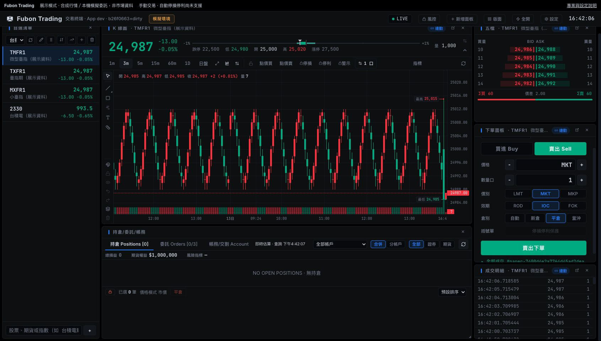

# Fubon Trading

[Shioaji Pro](https://github.com/Sinotrade/shioaji-pro-app) 的獨立 fork，保留開源交易介面，行情與交易服務改接 **富邦新一代 API（Fubon Neo 2.5.0）**。

本專案與永豐金、富邦均無官方合作或背書。授權維持 [AGPL-3.0](LICENSE)。[原始專案介紹](docs/UPSTREAM_README.md)。



## 啟動

需要 Node.js 22.12+、pnpm、[uv](https://docs.astral.sh/uv/)。

```sh
pnpm install --frozen-lockfile
cp .env.example .env
pnpm start
```

啟動後會自動開啟 **http://localhost:5179**。首次按「建立 Passkey 並解鎖」，由你在瀏覽器／系統提示中使用 Touch ID、裝置解鎖或安全金鑰完成註冊。Passkey 驗證要求使用者驗證，裝置或瀏覽器不支援時不會退回免驗證模式。

首次註冊只接受啟動視窗的一次性授權：連結兩分鐘內有效，交換後可在十分鐘內完成註冊；重新整理或關閉尚未註冊的分頁後，請重新啟動。註冊完成後可直接開啟 localhost 網址，以 Passkey 解鎖新工作階段；啟動連結無法略過 Passkey。原分頁可重新整理，服務重啟或登出後需重新驗證。

頂端「鎖定介面」會撤銷該工作階段，之後需再次驗證；不會取消既有委託或平倉。Passkey 驗證成功後，paper/live 才讀取 Keychain 並嘗試登入富邦。Passkey 不取代富邦 API Key 與憑證。

僅綁定本機，API 使用 `21323` 埠；埠被占用時停止啟動，不會接手其他交易服務。

預設為 **展示模式**：合成行情、模擬帳戶與本機撮合，不需券商帳號、不登入券商；本機介面仍要求 Passkey。頂端持續標示模式。

pnpm 12 若阻擋 esbuild 安裝腳本，可執行 `pnpm approve-builds esbuild --yes`；專案只允許該項建置依賴。

## 使用富邦行情

```sh
uv sync --directory server --extra fubon
```

登入資料僅儲存至 **macOS Keychain**，目前不提供其他作業系統的秘密儲存後端，也沒有明文備援。請在本機互動式終端機執行：

```sh
pnpm credentials set      # 隱藏輸入身分證字號、API Key、憑證密碼
pnpm credentials status   # 僅顯示是否已設定
pnpm credentials delete   # 刪除儲存資料；另需停止服務才能結束現有登入
```

設定時指定憑證完整路徑；憑證檔案必須只允許擁有者存取（權限 `600`）。Keychain 儲存登入欄位與憑證路徑，憑證檔案本身仍由你保管。若 macOS 詢問 Keychain 存取權限，請核對是本專案使用的 Python 執行檔。

在 `.env` 將 `FUBON_MODE` 改為 `paper`，重啟 `pnpm start`。API Key、憑證與帳號需完成富邦規定的申請及權限設定。建議先使用僅行情權限的金鑰，設定有效期限及可用的 IP 白名單。

舊版 `.env` 的四個登入欄位已停用；若其中仍有值，paper/live 會拒絕啟動。請先執行 `pnpm credentials set`，確認設定成功，再自行清除舊檔與備份中的明文資料。程式不會自動搬移或刪除你的秘密。

- `paper`：富邦真實行情，委託只進本機模擬帳簿。
- `live`：必須同時設 `FUBON_MODE=live` 與 `FUBON_ENABLE_LIVE_TRADING=true` 才能發送正式委託。修改後需重啟。
- 夜盤另設 `FUBON_SESSION=afterhours`。
- 登入失敗時顯示錯誤，不會退回合成行情。
- 金鑰與憑證只在 Python 服務使用，不會送給瀏覽器。不要將秘密放進 `VITE_*`。
- 行情、帳務、交易與串流要求 Passkey 驗證後的工作階段權限；啟動、Passkey 狀態與驗證端點不需要交易權限，但各自檢查啟動能力、Origin、challenge 與簽章。重啟後舊工作階段失效。
- 瀏覽器只在同源 API 的 Authorization 標頭附帶權限，拒絕重新導向；不使用 Cookie 或查詢參數。工作階段 token 存在該分頁的 sessionStorage；不進入 localStorage、Git 或建置環境。
- Keychain 與 token 可降低檔案外洩及未授權本機請求的風險，無法防止已控制你作業系統帳號或瀏覽器的惡意程式。

**尚未使用真實富邦帳號驗證登入、行情權限、改刪單或成交回報。** 富邦公開測試帳號目前僅提供證券；本機 paper 不是券商期貨測試環境。

## Passkey 復原與資料

```sh
pnpm passkeys status
# 遺失 Passkey 時，先以 Ctrl+C 停止 pnpm start，再執行：
pnpm passkeys reset
# 需在互動式終端機輸入 RESET PASSKEYS，之後重新 pnpm start 並註冊。
```

重設僅清除本機的 Passkey 公開驗證資料，不會刪除 Keychain 的富邦登入資料，也不會替你刪除裝置／密碼管理器中的舊 Passkey。沒有網頁重設或密碼登入備援。

macOS 公開驗證資料保存在 `~/Library/Application Support/Fubon Trading/passkeys.sqlite3`，包含隨機使用者識別碼、公鑰、credential ID 與計數器；私鑰由裝置或密碼管理器管理。Passkey 綁定 `localhost`，前端與單獨 dist 介面共用此 RP，但伺服器驗證精確 Origin（包含埠）。不要將資料庫放進 Git 或部署目錄。

## 功能範圍

| 功能 | 狀態 |
| --- | --- |
| K 線、均線、五檔、自選與可拖拉版面 | 沿用開源介面，改接本機富邦 bridge |
| 股票、期貨快照／即時行情／1 分 K | 已實作 SDK 轉接 |
| 期貨具體月、連續月看盤與歷史分 K | 已實作；未調整換月價差 |
| 股票現股整股／零股委託、期貨單式委託 | 已實作；整股張數轉成富邦股數 |
| 委託查詢、改價、取消、期貨減量 | 已實作；改刪前重新向券商查詢 |
| 股票部位、銀行餘額、期貨部位與權益 | 已實作 SDK 轉接；銀行餘額受交割銀行支援限制 |
| 本機模擬交易 | 已實作；不會呼叫券商下單 API |
| 複式單、信用下單、股票改量、零股即時行情 | 尚未支援，明確拒絕 |
| 選擇權篩選／歷史分 K、排行、指數成分與籌碼分析 | 尚未完成轉接 |
| 括號停損停利、觸價／定時／兩腳自動執行 | 停用，待成交回報與明細相容性驗證 |
| 自動產生策略、批次回測與樣本外驗證 | 後續工作，不包含在這次 API 遷移 |

上游 Tauri 外殼、AI Agent、策略回測是未公開的專屬模組，fork 不會取得；這裡交付 Web 交易終端。

模擬帳簿、自選清單存於服務記憶體，重啟即重設。撮合不模擬委託佇列、部分成交、手續費、稅或市場衝擊，不能用於評估策略績效。試撮或超過兩分鐘的舊報價不產生模擬成交。括號停損停利、觸價自動單、定時平倉與兩腳價差自動執行目前停用；不能視為部位已有自動保護。

## 開發與測試

```sh
pnpm server           # 只啟動 Python bridge，開啟 Passkey 解鎖的 dist/ 介面
pnpm dev              # 只啟動前端，不會單獨取得本機 API 授權；完整開發用 pnpm start
pnpm build            # TypeScript + 正式 Web build
pnpm test             # 既有前端測試
uv run --directory server --extra test --extra fubon pytest
```

建置後亦可執行 `pnpm server`，會自動開啟 http://localhost:21323 的 `dist/` 靜態終端，需以 Passkey 解鎖。API 文件在 http://localhost:21323/docs；API 呼叫仍需工作階段權限。

介接與官方規格來源見 [FUBON.md](docs/FUBON.md)。上游私有桌面發佈 workflow 在此 fork 不執行。
