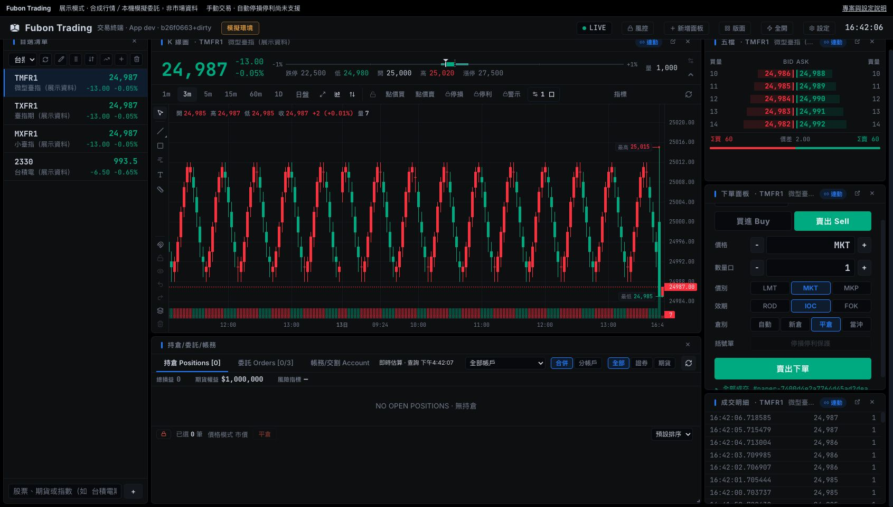

# Fubon Trading

[Shioaji Pro](https://github.com/Sinotrade/shioaji-pro-app) 的獨立 fork，保留開源交易介面，行情與交易服務改接 **富邦新一代 API（Fubon Neo 2.5.0）**。

本專案與永豐金、富邦均無官方合作或背書。授權維持 [AGPL-3.0](LICENSE)。[原始專案介紹](docs/UPSTREAM_README.md)。



## 啟動

需要 Node.js 22.12+、pnpm、[uv](https://docs.astral.sh/uv/)。

```sh
pnpm install --frozen-lockfile
cp .env.example .env
pnpm start
```

啟動後會自動開啟 **http://localhost:5179**。首次按「建立 Passkey 並解鎖」，由你在瀏覽器／系統提示中使用 Touch ID、裝置解鎖或安全金鑰完成註冊。Passkey 驗證要求使用者驗證，裝置或瀏覽器不支援時不會退回免驗證模式。

首次註冊只接受啟動視窗的一次性授權：連結兩分鐘內有效，交換後可在十分鐘內完成註冊；重新整理或關閉尚未註冊的分頁後，請重新啟動。註冊完成後可直接開啟 localhost 網址，以 Passkey 解鎖新工作階段；啟動連結無法略過 Passkey。原分頁可重新整理，服務重啟或登出後需重新驗證。

頂端「鎖定介面」會撤銷該工作階段，之後需再次驗證；不會取消既有委託或平倉。Passkey 驗證成功後，paper/live 才讀取 Keychain 並嘗試登入富邦。Passkey 不取代富邦 API Key 與憑證。

僅綁定本機，API 使用 `21323` 埠。macOS／Linux 再次執行 `pnpm start` 時，若確認同一個 checkout 的前端與 API 都正常，會顯示現有網址、PID 與操作指令並成功結束，不會額外啟動或重啟服務。只有部分服務在跑、無法確認程序身分或其他專案占用時，會保留程序並說明原因。

查詢與明確控制目前 checkout 的服務（macOS／Linux，需有 `lsof` 與 `ps`）：

```sh
pnpm status   # 專案路徑、模式、前端／API 埠、PID、網址及連線狀態
pnpm stop     # 核對程序身分後，停止這個 checkout 的前端與 API
pnpm restart  # 明確停止後，按目前設定重新啟動
```

`stop`／`restart` 會中斷目前工作階段；重啟後需要再次以 Passkey 解鎖，paper 模擬狀態會重設。停止服務不會自動取消券商端的委託或平倉。啟動器不會自動重啟、強制殺掉其他程序或掃描替代埠。舊版背景服務也能依工作目錄與執行指令辨識；若沒有啟動記錄，模式會明確標示為「未記錄」，並另外列出目前設定，避免把設定檔當成執行中的模式。

指定其他埠啟動時，查詢／停止／重啟都帶上同一組參數，例如 `pnpm stop -- --ui-port 5189 --api-port 21429`；`--` 將參數交給專案腳本，兼容 pnpm 10 與更新版本。Windows 保留原有啟動行為，尚不提供上述程序控制。

### 在 worktree 開發

在新 worktree 執行同一個 `pnpm start` 即可。啟動器會依 worktree 路徑選擇固定的一組前端／API 埠，印出網址並用預設瀏覽器開啟；主 checkout 仍使用 `5179`／`21323`。`status`／`stop`／`restart` 也依目前 worktree 選擇相同端點，不會停止另一個 worktree 的服務。

所有 worktree 都沿用本機應用程式資料夾中的同一份 Passkey 公開驗證資料，因此使用原本的 Passkey 解鎖即可，**不需複製資料庫、重設或重新註冊**。前端網址固定使用 `localhost`；每個服務仍只接受自己指定的精確 Origin，登入工作階段各自獨立。

需要自行指定埠時：

```sh
pnpm start -- --ui-port 5189 --api-port 21429
# 僅啟動服務、不開啟瀏覽器：
pnpm start -- --no-browser
```

新 worktree 沒有 `.env` 時使用展示模式；需要富邦行情時再按下節設定 `paper`。供人試用請使用正常啟動流程與平常的瀏覽器；`test:ui` 的臨時資料庫和虛擬 Passkey 只供自動測試，無法用你的既有 Passkey 解鎖。

預設為 **展示模式**：合成行情、模擬帳戶與本機撮合，不需券商帳號、不登入券商；本機介面仍要求 Passkey。頂端持續標示模式。

pnpm 12 若阻擋 esbuild 安裝腳本，可執行 `pnpm approve-builds esbuild --yes`；專案只允許該項建置依賴。

## 使用富邦行情

策略回測面板另提供 LightGBM 微台研究：跨月分批下載、資料品質、按日期訓練／驗證／測試、固定滑價壓力與版本保存。它只產生研究報告與本機模型，不自動啟動或替換交易策略，操作方式見[模型研究規格](docs/design/lightgbm-research.md)。macOS 需先安裝 OpenMP：

```sh
brew install libomp
```

`pnpm start` 會帶入 `learning` Python extra；缺原生依賴時，面板會顯示訓練不可用原因。

```sh
uv sync --directory server --extra fubon
```

登入資料僅儲存至 **macOS Keychain**，目前不提供其他作業系統的秘密儲存後端，也沒有明文備援。請在本機互動式終端機執行：

```sh
pnpm credentials set      # 隱藏輸入身分證字號、API Key、憑證密碼
pnpm credentials status   # 僅顯示是否已設定
pnpm credentials delete   # 刪除儲存資料；另需停止服務才能結束現有登入
```

設定時指定憑證完整路徑；憑證檔案必須只允許擁有者存取（權限 `600`）。Keychain 儲存登入欄位與憑證路徑，憑證檔案本身仍由你保管。若 macOS 詢問 Keychain 存取權限，請核對是本專案使用的 Python 執行檔。

在 `.env` 將 `FUBON_MODE` 改為 `paper`，重啟 `pnpm start`。API Key、憑證與帳號需完成富邦規定的申請及權限設定。建議先使用僅行情權限的金鑰，設定有效期限及可用的 IP 白名單。

舊版 `.env` 的四個登入欄位已停用；若其中仍有值，paper/live 會拒絕啟動。請先執行 `pnpm credentials set`，確認設定成功，再自行清除舊檔與備份中的明文資料。程式不會自動搬移或刪除你的秘密。

- `paper`：富邦真實行情，委託只進本機 SQLite 模擬帳簿，保存委託／持倉／成交費稅；支援微台策略，見 [Paper 操作規格](docs/design/paper-trading.md)。
- `sandbox`：使用官方測試帳戶登入固定的 `neoapitest.fbs.com.tw`，委託送到富邦測試主機，不讀正式 Keychain；設定方式見 [FUBON.md](docs/FUBON.md#官方測試環境)。
- `live`：必須同時設 `FUBON_MODE=live` 與 `FUBON_ENABLE_LIVE_TRADING=true` 才能發送正式委託。修改後需重啟。

也可在畫面上方「交易模式設定」選擇模式，無須手動修改 `.env`。切入正式交易必須另外開啟「允許正式下單」、輸入「確認啟用正式下單」並套用；正式模式每筆手動委託仍必須經過委託確認，不能關閉。套用會自動重啟這個服務並要求既有 Passkey 重新解鎖；有策略監控、研究工作、未完成委託或持倉時阻擋切換。本機選擇保存在各工作目錄的 `server/.mode-settings.json`，之後啟動優先沿用，`.env` 作為初始設定；不更改 Keychain 或其他 worktree 的服務。
- 夜盤另設 `FUBON_SESSION=afterhours`。
- 登入失敗時顯示錯誤，不會退回合成行情。
- 金鑰與憑證只在 Python 服務使用，不會送給瀏覽器。不要將秘密放進 `VITE_*`。
- 行情、帳務、交易與串流要求 Passkey 驗證後的工作階段權限；啟動、Passkey 狀態與驗證端點不需要交易權限，但各自檢查啟動能力、Origin、challenge 與簽章。重啟後舊工作階段失效。
- 瀏覽器只在同源 API 的 Authorization 標頭附帶權限，拒絕重新導向；不使用 Cookie 或查詢參數。工作階段 token 存在該分頁的 sessionStorage；不進入 localStorage、Git 或建置環境。
- Keychain 與 token 可降低檔案外洩及未授權本機請求的風險，無法防止已控制你作業系統帳號或瀏覽器的惡意程式。

**尚未使用真實富邦帳號驗證登入、行情權限、改刪單或成交回報。** 富邦目前提供證券及期貨官方測試帳號；本機 paper 與官方 sandbox 為不同模式。

## Passkey 復原與資料

```sh
pnpm passkeys status
# 遺失 Passkey 時，先以 Ctrl+C 停止 pnpm start，再執行：
pnpm passkeys reset
# 需在互動式終端機輸入 RESET PASSKEYS，之後重新 pnpm start 並註冊。
```

重設僅清除本機的 Passkey 公開驗證資料，不會刪除 Keychain 的富邦登入資料，也不會替你刪除裝置／密碼管理器中的舊 Passkey。沒有網頁重設或密碼登入備援。

macOS 公開驗證資料保存在 `~/Library/Application Support/Fubon Trading/passkeys.sqlite3`，包含隨機使用者識別碼、公鑰、credential ID 與計數器；私鑰由裝置或密碼管理器管理。Passkey 綁定 `localhost`，前端與單獨 dist 介面共用此 RP，但伺服器驗證精確 Origin（包含埠）。不要將資料庫放進 Git 或部署目錄。

## 功能範圍

| 功能 | 狀態 |
| --- | --- |
| K 線、均線、五檔、自選與可拖拉版面 | 沿用開源介面，改接本機富邦 bridge |
| 股票、期貨快照／即時行情／1 分 K | 已實作 SDK 轉接 |
| 期貨具體月、連續月看盤與歷史分 K | 已實作；未調整換月價差 |
| 股票現股整股／零股委託、期貨單式委託 | 已實作；整股張數轉成富邦股數 |
| 委託查詢、改價、取消、期貨減量 | 已實作；改刪前重新向券商查詢 |
| 股票部位、銀行餘額、期貨部位與權益 | 已實作 SDK 轉接；銀行餘額受交割銀行支援限制 |
| 本機模擬交易 | Paper 保存委託、持倉與費稅；不會呼叫券商下單 API |
| 複式單、信用下單、股票改量、零股即時行情 | 尚未支援，明確拒絕 |
| 選擇權篩選／歷史分 K、排行、指數成分與籌碼分析 | 尚未完成轉接 |
| 圖表／條件單引擎的括號、觸價／定時／兩腳執行 | 停用，待成交回報與明細相容性驗證 |
| 日內回測研究與 SQLite 資料庫 | 新增公開面板；歷史 1 分 K 快取、固定假設權重、ORB 濾網對照、成本／滑價與紀錄保存，見 [規格](docs/design/intraday-research.md) |
| LightGBM 微台訊號研究 | 跨月資料、固定事件標籤、時間切分、成本壓力、模型保存／匯出；研究模型不核准自動交易 |
| Paper／Sandbox 策略自動交易 | 「新增面板 → 自動交易」；微台單口、指定日盤、限價 IOC、啟停／對帳與本機退出監控，見 [執行流程](docs/design/sandbox-auto-trading.md) |
| 自動產生策略、最佳化與樣本外驗證 | 後續工作；研究面板不包含上游私有完整回測模組 |

上游 Tauri 外殼、AI Agent、完整策略回測是未公開的專屬模組，fork 不會取得；公開 fork 另外提供範圍受限的日內研究面板與 Web 交易終端。

Paper 委託、持倉、凍結成本與策略紀錄保存在本機資料庫；demo 帳簿及自選清單仍為記憶體資料。臺指／小台／微台逐口計算成交手續費與期交稅；其他商品未設定的成本會明示，不能視為零成本。撮合不模擬委託佇列、部分成交、保證金占用或市場衝擊。試撮或超過兩分鐘的舊報價不產生模擬成交；策略另要求15秒內報價。圖表與條件單引擎的括號停損停利、觸價自動單、定時平倉及兩腳價差執行目前停用；paper／sandbox 策略面板另由後端監控，重啟不自動接管。

## 開發與測試

```sh
pnpm server           # 只啟動 Python bridge，開啟 Passkey 解鎖的 dist/ 介面
pnpm dev              # 只啟動前端，不會單獨取得本機 API 授權；完整開發用 pnpm start
pnpm build            # TypeScript + 正式 Web build
pnpm test             # 既有前端測試
uv run --directory server --extra test --extra fubon --extra learning pytest
```

建置後亦可執行 `pnpm server`，會自動開啟 http://localhost:21323 的 `dist/` 靜態終端，需以 Passkey 解鎖。API 文件在 http://localhost:21323/docs；API 呼叫仍需工作階段權限。

介接與官方規格來源見 [FUBON.md](docs/FUBON.md)。上游私有桌面發佈 workflow 在此 fork 不執行。
