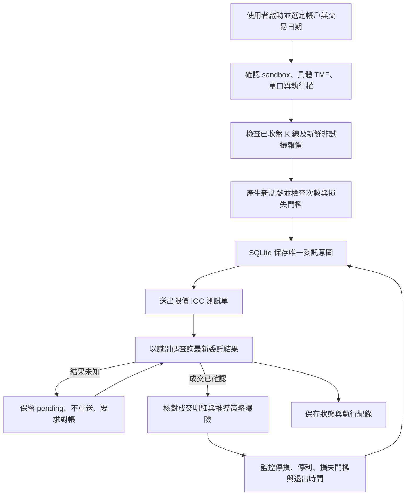

# Sandbox 自動交易面板與執行流程

查證與設計日期：2026-11-15。第一版只支援既有富邦官方 sandbox 的微台單口、指定單日日盤；初始停用，由使用者在「新增面板 → 自動交易」按啟動。demo、paper、live 均不能啟動此執行器。

## 流程依據與本版對應

[QuantConnect 的 Algorithm Framework](https://www.quantconnect.com/docs/v2/writing-algorithms/algorithm-framework/overview) 將訊號、配置、風控與執行拆開；[Alpaca 的委託文件](https://docs.alpaca.markets/us/docs/orders-at-alpaca) 說明委託識別與後續狀態查詢。這些只作流程設計參考，不把其他市場的撮合、保證金或 API 語意套用到富邦。

實際委託、查詢與成交欄位以富邦 [place_order](https://www.fbs.com.tw/TradeAPI/docs/trading-future/library/python/trade/PlaceOrder/)、[get_order_results](https://www.fbs.com.tw/TradeAPI/docs/trading-future/library/python/trade/GetOrderResults/)、[filled_history](https://www.fbs.com.tw/TradeAPI/docs/trading-future/library/python/trade/FilledHistory/) 為準。

送單回覆不等於已成交；`user_def` 也不是券商提供的冪等保證。應用程式對每個已保存意圖只呼叫一次 SDK。回覆逾時後，用 `FA`＋8 位十六進位的 10 字元識別碼查詢；查無結果保留未知，不再下另一張。每次退出重試必須已確認上一張終結且未成交，最多三張退出意圖。

## 策略與時序

- 09:00–09:15 建立現貨開盤對齊區間；09:20–13:10 於新完成的 5 分收盤判斷穿越。啟動／恢復時設時間水位，不追補更早的訊號。
- 必須有首 15 根與最近兩根 5 分區間的完整分鐘資料；只用已完成 K 棒。權值濾網可選，需各股票在決策時刻與五分鐘前的精確收盤；預填權重是探索性固定假設。
- 每次固定 1 口、單一策略曝險、每方向最多一個進場意圖；同帳戶同日最多 1–2 次進場意圖。未成交、未知或送出前中止也占額度，重新啟動不重設。
- 訊號確認後以當時買賣價加指定點數建立限價 IOC。與歷史回測的下一根開盤成交近似不同，不能把兩者績效視為相同。
- 停損停利以**進場限價**為錨，13:20 嘗試退出。這是本機每 5 秒輪詢的條件邏輯，沒有建立券商端保護單，也不保證觸價即成交。
- 報價須屬指定交易日期、非試撮、買賣價有效且不超過 15 秒；每張下單前再次檢查模式、控制權、時段及行情。日期選擇只檢查平日，未內建完整交易所休市曆；休市時沒有新鮮行情就不下單。

## 策略檢查與研究狀態

面板固定顯示「策略驗證：研究中」。啟動通過的是 sandbox 執行條件，沒有宣告策略具有正期望值，也沒有把歷史回測結果綁成這套即時 IOC 執行器的績效。

| 層次 | 已檢查 | 尚待驗證 |
| --- | --- | --- |
| 訊號正確性 | 開盤區間、已完成 5 分穿越、缺漏分鐘不交易、股票時間同步、不讀未來價格 | 與盤中實際資料發布延遲的對照 |
| 執行與風控 | 單口與次數上限、停損停利／時間退出、未知結果不重送、成交對帳、重啟及並行鎖 | 真實 sandbox 盤中委託與成交回報 |
| 獲利優勢 | 歷史工具估計雙邊費稅與滑價，同分鐘停損停利衝突採停損優先；已做短樣本基準／濾網比較 | 獨立樣本外、分段向前測試、參數穩定性、較差成本／延遲／未成交情境及持續前測 |

目前探索樣本只有七個交易日，固定權值股濾網未改善該樣本結果。這不足以估計穩定勝率或推論其他行情。後續研究須先固定規則與評估方式，再保留未參與調整的日期；同時評估扣成本後每筆期望、最大回撤、盈虧比與不同時段表現。反覆調參後仍用原樣本宣告成功，會產生過度擬合；驗證原則參考 [QuantConnect Research Guide](https://www.quantconnect.com/docs/v2/writing-algorithms/key-concepts/research-guide)。正式交易始終不在本執行器支援範圍。

## 成交、曝險與損益

策略只使用本輪權威委託清單，不能拿 `order_list` 中保留的舊快取當作本輪存在。識別碼、日期、帳戶、具體商品、方向、單口與 IOC 類型都須吻合；重複或不一致資料轉為需處理。

曝險從自己已確認的成交增減推導，重建不依賴報價查詢成功。成交價取 `filled_history.filled_price`，按日期、委託書號、帳戶、商品與方向核對，以 `filled_no` 去重並驗證口數。**不從委託限價或 `filled_money` 猜成交價。** 價格明細尚未對齊時損益顯示未知、禁止新倉；已知曝險仍依限價錨監控退出。

損益使用設定費率估計，不是券商帳務。損失門檻是停止新增曝險與請求退出的控制，不是保證最大虧損。共用 sandbox 帳戶的總庫存可能被其他人操作改變，tag 無法隔離帳戶庫存；本面板不以帳戶總部位猜測策略持倉，退出遭拒時須人工處理。

## 控制與故障處理

| 狀況／控制 | 行為 |
| --- | --- |
| 停止新倉 | 阻擋新進場；已送出意圖仍需確認，既有曝險繼續退出監控 |
| 停止並退出 | 先重建已確認成交曝險；有 pending 先對帳，有曝險才送自有退出單，不能把報價失敗誤當無部位 |
| 全域風控鎖 | 阻擋新倉與退出送單；正在執行的 SDK 呼叫仍須查明結果，取消只限自有已確認委託 |
| 面板關閉／工作階段鎖定／15 秒無有效心跳 | 暫停新倉；後端在線且未被全域風控鎖阻擋時仍監控退出 |
| 排隊或較舊的心跳 | 以伺服器收到時間判斷，不能延長控制權或解除較新的鎖定 |
| 行情串流中斷／過期報價 | 不送單；退出受阻時保留曝險與人工處理提示，不假稱已平倉 |
| 送出、取消結果未知 | 保留意圖與待確認狀態，只查詢、不重送 |
| 服務重啟 | 載入紀錄但不自動接管；按重新對帳、啟動或停止退出後才允許相應動作 |
| 人工確認並封存 | 使用者先處理測試委託／部位，再輸入確認文字；只結束本機追蹤，不撤單或平倉，本日不能重新啟動，過期控制不能重開 |

SQLite 單一 writer lease 避免同 DB 的兩個後端同時執行；新倉另綁定已驗證工作階段與面板心跳。心跳遇到長 RPC 排隊不能從處理時刻重新取得完整租期。控制鎖以即時 admission flag 阻擋尚未開始的 SDK 發送；已進入 SDK 的呼叫不能宣稱可撤回。

## 模組與驗證邊界

- `auto_trading.py`：策略與委託狀態機；`auto_gateway.py`：sandbox 限縮介面；`auto_store.py`：持久化與 writer lease。
- `Broker.place/mutate` 保留手動預設，只為內部策略 tag 增加 sandbox、日盤、微台單口限價 IOC 與自有取消的硬限制。既有圖表／條件單引擎的富邦自動執行仍停用。
- `research_auto_runs` 保存帳戶＋交易日計畫與意圖；`research_auto_events` 保存紀錄。已收盤分鐘 K 增量寫入共用 `research_bars`，但不宣告整個交易日的歷史快取覆蓋。
- 驗證包含假 SDK 狀態機、持久化／重啟、HTTP 存取控制、並行風控、隔離瀏覽器與深淺窄版畫面。FakeGateway 成交不等於券商成交；真實盤中自動成交及策略樣本外收益仍須另外驗證。交付時不替使用者啟動待交易計畫。
