# shadcn/ui 元件遷移

本專案的共用介面控制改用官方 shadcn/ui（Radix、new-york），來源放在
`src/components/ui/`，設定在根目錄 `components.json`。行情 Canvas、五檔／閃電
梯形、grid 面板與交易專用布局仍由原本的程式及 vanilla-extract 負責。

## 元件與主題

- 按鈕、文字／數字／日期／色彩輸入、多行輸入、原生選單、Checkbox、Switch、
  Slider、RadioGroup、Label、Field 與 Table 皆使用共用元件；非 UI 基礎層不再
  直接宣告這些原生 JSX 控制項。
- Passkey 頁面使用 Card、Button、Alert、Separator；驗證成功後與交易介面共用
  React root，原先的工作階段與首次註冊授權流程不變。
- 設定、版面庫、面板庫、技術指標、自訂指標、繪圖物件設定與委託確認使用
  `TerminalDialog` 組合 shadcn Dialog。它保留 Escape stack、忙碌鎖定、IME
  與焦點返回；繪圖輸入框的 Escape 還原保留專用處理。
- 設定、指標及繪圖分頁使用 Tabs；報價欄設定使用 Popover + Tabs；面板連動
  選單使用 DropdownMenu；條件單選項使用 ToggleGroup。
- 通知改用 Sonner；通知內容持續訂閱隱私與大小設定，已出現的文字也會即時遮蔽。
- 行情／交易專用浮層仍保留原有定位及狀態邏輯，其內部共用控制項使用 shadcn。
- 主畫面面板使用 Card／CardHeader，深淺色共用 Absolutely 暖灰／暖白色票；移除共用控制項
  原有的配色、邊框與焦點樣式覆蓋，由元件 variant 呈現選取、主要與危險動作。
  買賣方向保留語意色，台股／國際的紅綠方向慣例不變。

保留原本的 grid、面板位置與比例、工具列行數、控制項尺寸與資訊密度，包括
頂欄控制項高度、設定視窗的 38rem／30rem 尺寸及原有響應式門檻。這是外觀與共用
元件遷移，不改成範例 dashboard 的布局；交易介面繼續使用 compact 尺寸。
交易面板的 CardHeader 明確使用 panel 布局，避免預設直排／大內距與原樣式
競爭；登入卡片仍沿用預設直排。樣式載入順序改變時，面板標題列也維持橫向。
設定、版面庫與新增面板的 Dialog 明確由原有 CSS 控制幾何，避免熱更新後被共用彈窗的
全寬、置中與零內距覆蓋。帳號名稱／狀態分行，預設版面說明在各自卡片內
換行並保留兩行摘要，不改動版面庫欄數及卡片寬度。

深色使用不同明度的背景、面板與浮層，提亮次要文字、輸入邊界、圖表刻度及
紅綠價格；Canvas 與熱力圖同步套色。白字標籤使用較深的 Solid 語意色，與
價格文字分開。分頁的選取細框與鍵盤焦點框分開，均不占用布局尺寸。

shadcn 語意 CSS 變數透過 `theme.css.ts` 接到共用的 `lib/theme-palette.ts`，支援深色、淺色、
自訂配色及台股／國際漲跌慣例。延續舊 WebView 的建置目標，使用 Tailwind 3
與 tailwind-merge 2；透明色使用既有 Dim 語意 token，不依賴 Tailwind 4 或
新的 color-mix 語法。舊版 Safari／原生 WebView 仍需實機驗收。

`NativeSelect` 的 `wrapperClassName` 負責外框的 flex／grid 尺寸；透明疊在帳號
標籤上的選單使用全尺寸外框與 `showIcon={false}`，原生 ref 仍傳給 select。

Radix 控制項可能輸出 button／span，因此共用 `keyboard-target.ts` 同時供交易
與圖表快捷鍵使用，避免勾選框或滑桿上的按鍵變成下單方向、繪圖或全部刪單指令。
React、React DOM 與 scheduler 固定在同一 bundle chunk，避免 vendor 尺寸拆分
與 Radix scroll-lock 相依形成 CommonJS 初始化循環。

## 驗證與試用

```bash
pnpm build
pnpm test
pnpm test:ui
```

`test:ui` 需要 uv 與 Chrome（可用 `PLAYWRIGHT_CHANNEL` 指定已安裝的 Playwright
瀏覽器 channel）。它建置正式前端 bundle，另啟展示後端與 preview，使用臨時
Passkey 資料庫和虛擬驗證器；不讀 Keychain、不連富邦、不確認送出委託。預設
測試埠是 5186／21426，已占用會拒絕啟動，也可用 `SHADCN_UI_PORT`／
`SHADCN_API_PORT` 指定。正常結束或 SIGINT／SIGTERM 都會清理本次子程序。
截圖留在輸出的臨時資料夾，可用 `SHADCN_ARTIFACT_DIR` 指定位置。

此次驗證結果：

- TypeScript project build 通過。
- Vitest：352 個測試檔、5,539 項測試通過；原有 1 檔／2 項略過。
- CI 的 Python release-notes 工具測試：10 項通過。
- 正式 bundle 的 Chrome 驗收：Passkey 註冊／解鎖、展示行情 LIVE、深淺及自訂
  主題、焦點返回、分頁鍵盤、連動選單、報價欄設定、開啟並取消委託確認、390px
  窄視窗均通過。SIGTERM 中斷後兩個測試埠確實釋放。
- 外觀驗收另檢查主題切換前後面板位置與尺寸一致、排序按鈕不跨列、自訂白底
  深字的輸入框可讀性，及深淺色買賣按鈕對比至少 4.5:1；hover 維持同一文字色。
- Absolutely 主題的一般小字與次要標籤至少 4.5:1、輸入邊界至少 3:1、五檔滑過加量條的價格至少
  4.5:1、已選分頁的鍵盤焦點。實心交易標籤獨立產生深底色，白字與 hover 狀態
  持續符合 4.5:1；一般文字的 4.5:1 門檻取代原中性主題標籤的 7:1 驗收值。
- Switch 明確清除瀏覽器預設 padding，三種字級的開／關圓點皆留在軌道內；
  右下縮放把手的弧線配合 Card 圓角，拖曳熱區仍為 20×20px。
- 拖曳／縮放時，外層陰影與佔位虛線框使用和 Card 相同的圓角；深淺色皆以
  實際按住把手縮放驗證，復原後面板位置與尺寸一致。
- 正式 bundle 重播最後載入的 Tailwind 布局規則，深淺色六個面板仍為橫向、
  緊湊標題列；登入 CardHeader 保留直排。
- 帳號與版面庫的長文字，在深淺色、標準／大字級、720／390px 正式 bundle
  實測不越界；晚載入 Tailwind 後，設定視窗仍維持 38rem 上限、7vh 頂距與
  原內距，版面庫維持 680px 上限。獨立 QA 另驗 1440px 與 180px 窄帳號按鈕。
- 新增面板視窗維持 760px 上限、10vh 頂距，1440／640／390px 時分別為
  三／二／一欄。尾載 Tailwind 後卡片仍為靠左 grid，圖示、文字與「前往」
  各居其欄；搜尋、分類收合、方向鍵與新增／前往操作通過正式 bundle 及獨立 QA。
  480px 以下隱藏快捷鍵提示，避免擠壓搜尋框；390px 搜尋輸入寬度仍大於 200px。
- 設定六分頁的內容右留白由 2px 增為 1rem；繪圖色盤右留白由 6px 增為
  0.5rem。顯示實際捲軸後驗證控制與右側捲軸間距，並檢查版面庫、面板庫、
  指標／繪圖設定、報價欄、條件單及伺服器設定；其他區域原有內距足夠。
  正式 bundle 另驗六分頁在桌面及窄版均至少保留 8px、無水平溢出，外框尺寸不變。
- AI review 與 QA 找出的快捷鍵、分頁高度、選單外框、選取／危險狀態及語意色
  問題已修復並重驗；最終沒有未處理的 confirmed findings。

此 fork 未含 `src-tauri/` 與私有原生 shell，因此上述是 Web／正式前端 bundle
驗收；未宣稱原生 App、實機 Touch ID、舊 WebView 或真實券商交易已驗收。
一般開發與使用仍沿用 README 的 `pnpm start` 流程。

## Worktree 整合

共用元件、設定布局、持倉分頁與緊湊控制項的重疊變更已合併，並補回設定分支的
通知回歸測試及緊湊控制項分支的正式 bundle 驗收。自選清單動作保持同組，窄面板
允許換行；圖示按鈕保留固定尺寸，表單列中的輸入、選單與按鈕由同一列控制高度。
設定選項使用 Field 與 RadioGroup，窄視窗仍可完整讀取漲跌停選項。

Absolutely 主題沿用 shadcn variants 與新版 Passkey React 畫面；內建、自訂起始色
及 Canvas 圖表共用色票。深色買賣控制項文字在淡紅綠底上額外提亮，並提高輸入框
邊界對比，修正主題與元件整合後的可讀性回歸。已儲存的自訂六色維持原值。
通知使用 Sonner 標準標題與描述欄位，隱私切換即時遮蔽；調整大小更新原通知 ID，
不重播事件或音效。

## 畫面（展示資料）

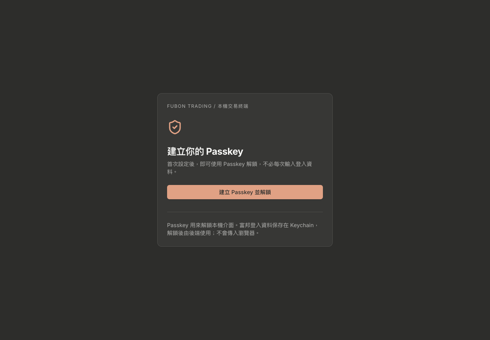

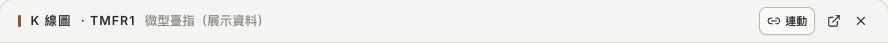

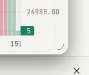

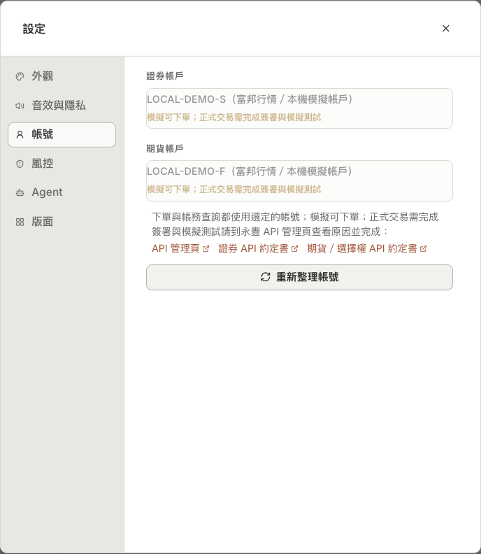

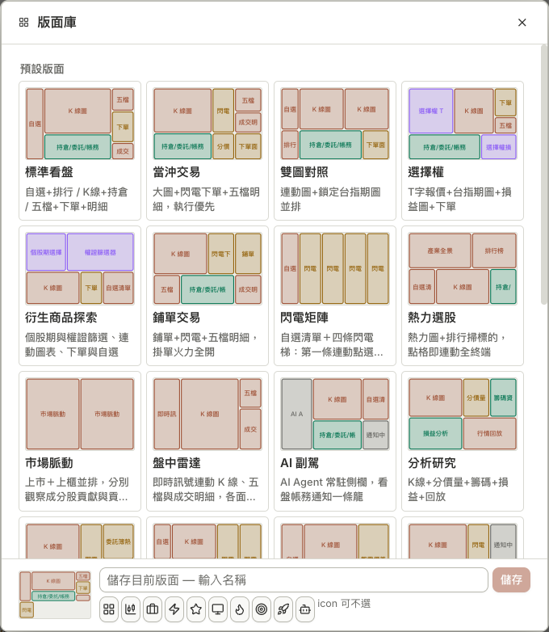

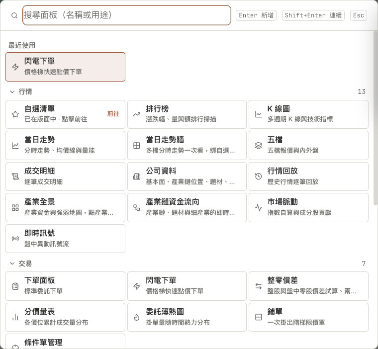

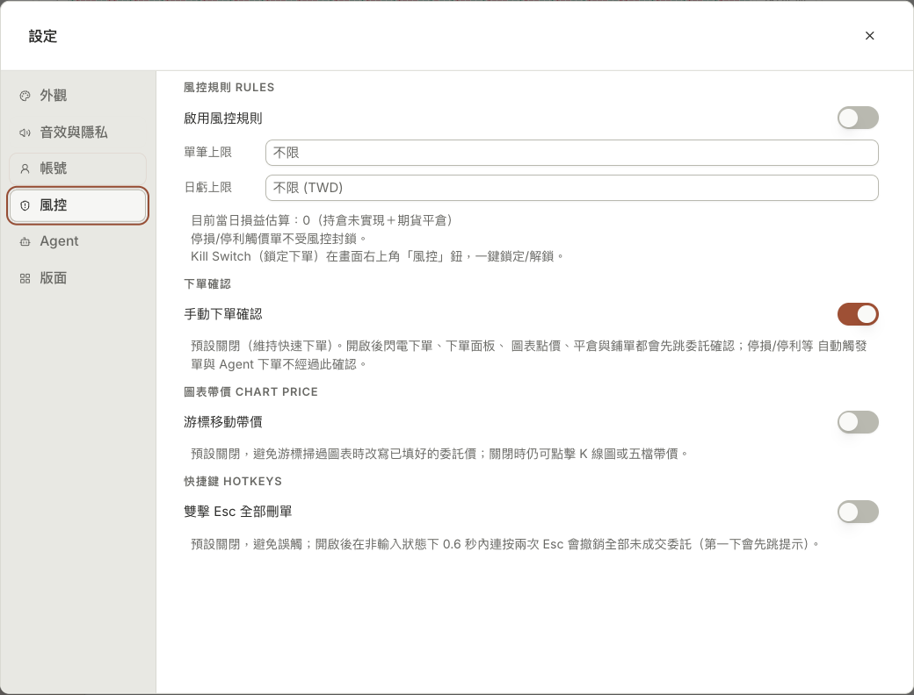

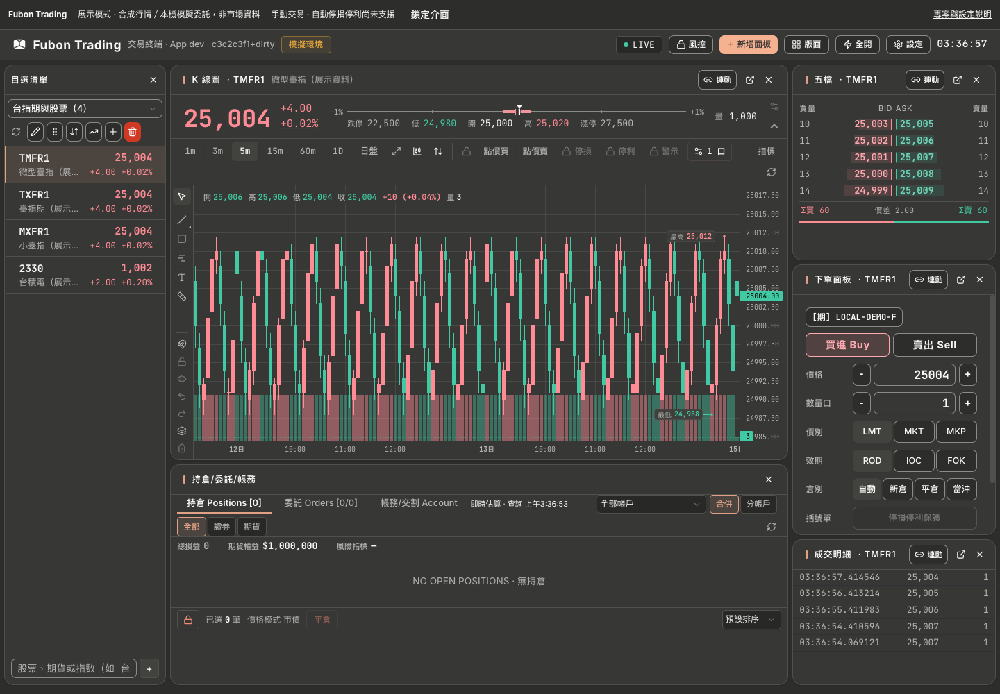

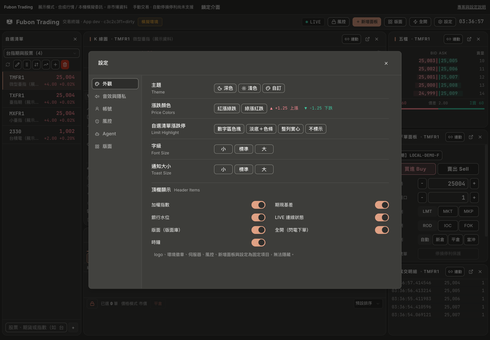

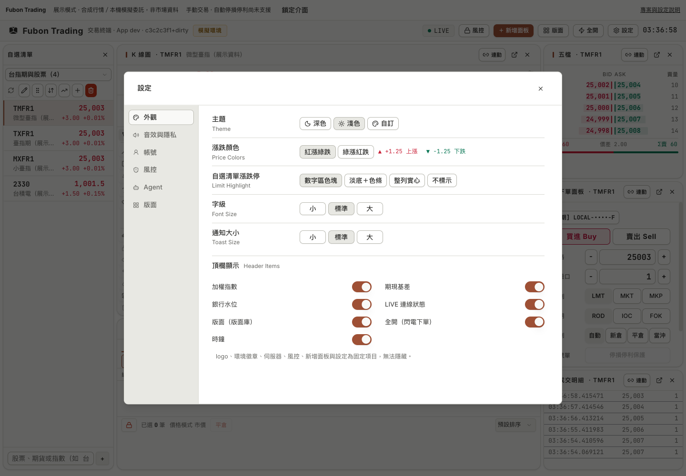

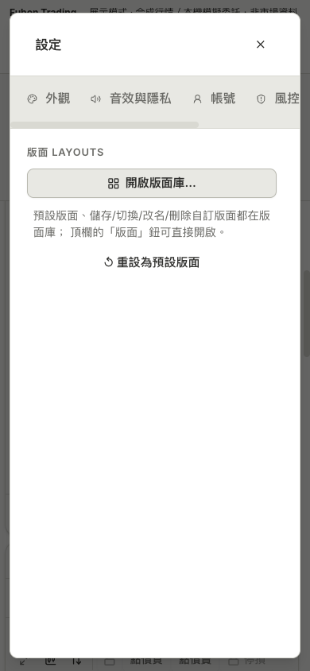
